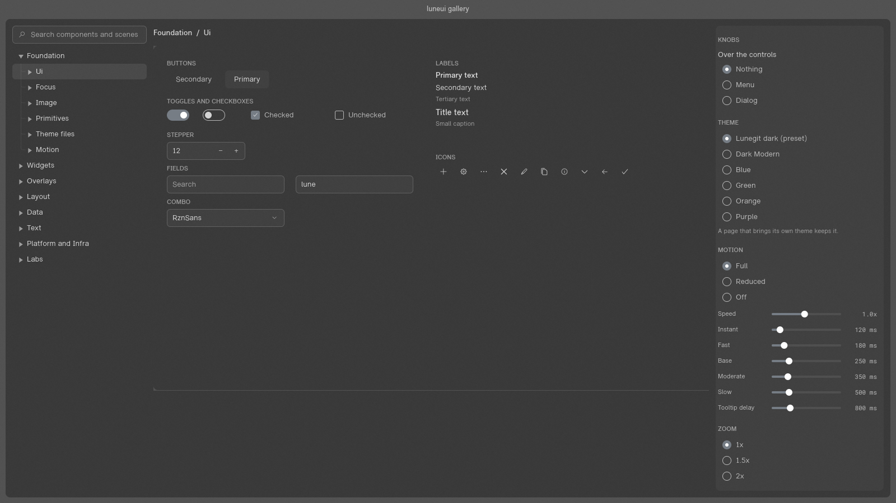
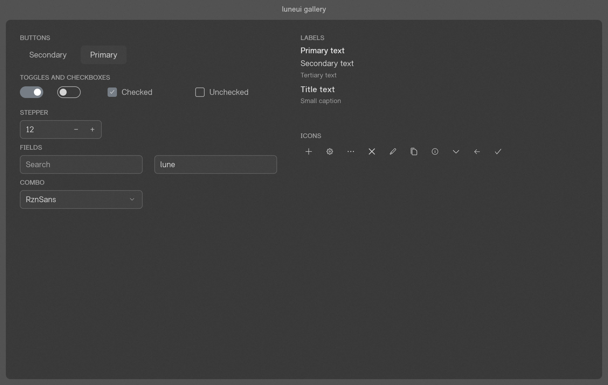
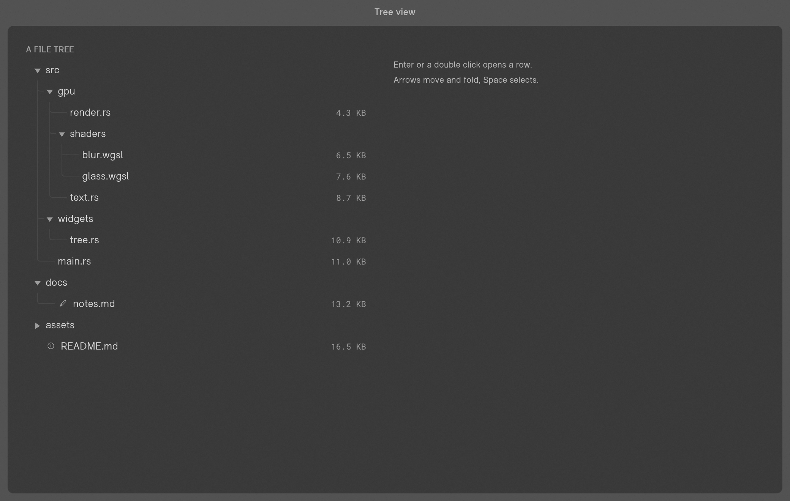
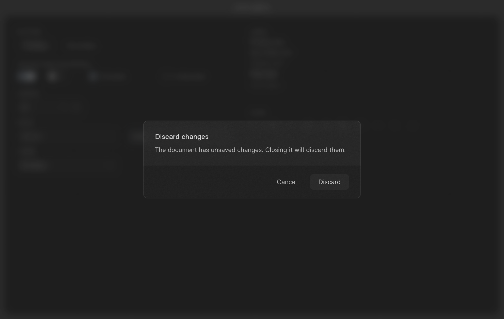
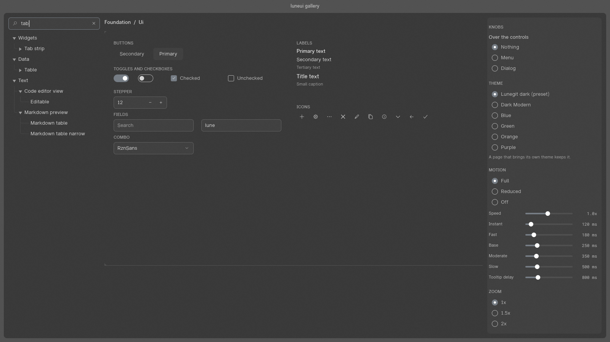

# luneui-rs

A native Rust UI toolkit for glass-style desktop apps: an immediate-mode painter on
[wgpu](https://wgpu.rs), close to 100 catalogued components, OS glass materials, window helpers and theme tokens.
No web engine and no CSS: styles are Rust values.



It was extracted from the Luneterm terminal's UI layer so several Rust apps can share it. Its look
follows Lunegit, a desktop git client. The toolkit itself is app-agnostic: no app or domain words
appear in library code, and a script enforces that.

**Status:** in development, version 0.2.0, not on crates.io (`publish = false`). The API still
changes; `docs/consuming.md` lists every change in its migration maps.

## What is in it

- **A painter and a display list.** Rounded fills, strokes, paths, text, images and glass, recorded
  into a `Scene` and drawn by wgpu. Frames are deterministic: the app passes in time, sizes, fonts and
  theme, and the toolkit never reads the clock or the environment.
- **Widgets.** Buttons, fields, text areas, a code editor, markdown, a diff view, tables, a tree view,
  tab strips, menus, dialogs, popovers, tooltips, toasts, a command palette, a lane graph and more.
  All of them have keyboard focus, disabled states, motion tiers (full, reduced, off) and an
  accessibility tree, bridged to AccessKit by an optional feature.
- **Glass.** Every in-window glass surface frosts the app content behind it, stacked: a dialog
  frosts the page, a list in the dialog frosts the dialog. The window's own background can use the
  OS material (macOS vibrancy, Windows acrylic or Mica).
- **Themes.** One `Theme` value colours everything. Load one from JSON, or use the built-in dark preset.
- **Platform pieces.** Window helpers (caption buttons, edges), a tray item and its popover window,
  and clipboard requests.

| | |
|---|---|
|  |  |
|  |  |

These images are the gallery's own scene renders: the headless dumps its pixel gate compares.

## Try it

```bash
cargo run -p gallery          # the showcase window: every page live, with knobs and settings
```

Cmd or Ctrl `]` and `[` walk the pages; Cmd or Ctrl `Q` quits. `cargo run -p gallery -- --list`
prints the scene names, and `-- --dump <dir>` renders them all to PNG without a window.

The pinned toolchain is Rust 1.92.0 (`rust-toolchain.toml`); the minimum is 1.85, edition 2024. Day to day it
runs on macOS. Windows passes clippy and Linux builds in Docker (`scripts/check-targets.sh`), but
neither has had a full run, and Linux has no tray.

## Crates

| crate | what it holds | depends on |
|---|---|---|
| `lune-ui-core` | painter, scene, widgets, theme, text editing, the seam types and their fakes | nothing (no wgpu, winit or glyphon types) |
| `lune-ui-wgpu` | GPU device, frame renderer, window surfaces, blur and glass, glyphon text | core, wgpu, glyphon |
| `lune-ui-winit` | window attributes, input translation, output | core, winit |
| `lune-ui-platform` | OS glass materials, tray item, popover window (the only `unsafe` code) | core, OS crates |
| `lune-ui` | the facade: one `lune_ui::<module>` path for everything | the four above |

An adapter never depends on another adapter. Each seam (text, images, input and output, glass
backdrop) has a fake and a contract test in `lune_ui_core::testing`, so you can test a widget without a GPU.

## Using it in an app

There is no composition root: the app owns the event loop, creates the windows and wires the
adapters. Each frame it passes in `RawInput` (time, pointer, keys, size, scale), calls widgets on a
`Ui`, and acts on the `FrameOutput` (window commands, cursor, clipboard, repaint, accessibility).
`apps/gallery` is the worked example: `apps/gallery/src/window.rs` has the window, the surface and
the frame loop.

Depend on the facade by git:

```toml
[dependencies]
lune-ui = { git = "https://github.com/lune-rs/luneui-rs" }   # optional feature: accesskit
```

or vendor a snapshot (`scripts/export-snapshot.sh`). `docs/consuming.md` covers both, along with the
app's duties and the release size.

## Developing

```bash
cargo build --workspace
cargo test --workspace                                  # GPU tests skip without an adapter
cargo clippy --workspace --all-targets -- -D warnings
cargo fmt --all
scripts/check-boundaries.sh                             # app-agnostic, no clock or env, unsafe placement
scripts/gen-component-index.sh                          # regenerate docs/components/INDEX.md
scripts/pixel-gate.sh                                   # render every scene before and after, compare
```

`CLAUDE.md` has the full gate line run before every commit, and the rules behind it.

## For LLMs and coding agents

Read these in this order, and only as far as the task needs:

1. `CLAUDE.md` (`AGENTS.md` points to it): commands, the gate, architecture rules, and the hard rules
   that the boundary script and lints enforce.
2. `docs/STATE.md`: what is being worked on now, what's next, and the known limits.
3. `docs/DECISIONS.md`: every decision with its reason and what was rejected. Don't re-open one
   unless the user asks.
4. `docs/architecture.md`: the module map, seams, draw order, multi-window model and pixel gates.
5. `docs/components/INDEX.md` (generated): every component, with one file each under
   `docs/components/<area>/<id>.md` giving its API, look values with their sources, states, tests
   and what is unverified.
6. `docs/consuming.md`: how an app takes the toolkit in, plus the migration maps of API changes.

Rules that catch newcomers:

- Library code never reads the clock or the environment and never starts an event loop.
- A widget takes every colour from `ui.theme()`, never a literal.
- `unsafe` is allowed only in `lune-ui-platform` under `src/platform/` or `src/material/`.
- A change to a component's drawing passes the pixel gate. An intended look change names its scenes
  with `--allow` and adds a DECISIONS row.
- New behaviour goes in a new module or a `Theme` value, not in a patch to an app-specific path.

## Licence

Licensed under either of [MIT](LICENSE-MIT) or [Apache-2.0](LICENSE-APACHE), at your option.
Bundled third-party assets (fonts, the acrylic noise texture, Avalonia's colour formulas) keep their
own licences; see `THIRD_PARTY_NOTICES.md` and `licenses/`.
